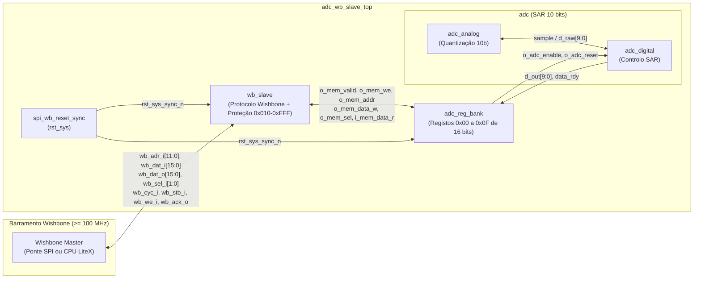

# Especificação de Design: Banco de Registos (Wishbone Slave) Conectado ao ADC SAR de 10 Bits

## 1. Visão Geral e Arquitetura

O módulo [`adc_wb_slave_top`](../rtl/src/adc_wb_slave_top.sv) implementa o **Banco de Registos (REG BANK)** atuando como um **Wishbone Slave** clássico (12 bits de endereço, 16 bits de dados, operando em $\ge 100\text{ MHz}$) e já possui integração direta com o RTL do núcleo do conversor analógico-digital **[`adc`](../rtl/src/adc.sv)** ([`adc_analog`](../rtl/src/adc_analog.sv) + [`adc_digital`](../rtl/src/adc_digital.sv)).

---

## 2. Requisitos de Relógio, Reset e Portas

### 2.1 Relógio e Reset
- **`clk` ($\ge 100\text{ MHz}$)**: Relógio principal do sistema e do barramento Wishbone.
- **`rst_sys`**: Reset ativo em nível baixo (`0`), sincronizado internamente por [`spi_wb_reset_sync`](../rtl/src/spi_wb_reset_sync.sv) com **ativação (assert) assíncrona** e **desativação (deassert) síncrona**.

### 2.2 Tabela de Portas (`adc_wb_slave_top`)

| Porta | Direção | Largura | Descrição |
|---|---|---|---|
| `clk` | Input | 1 bit | Relógio principal do sistema ($\ge 100\text{ MHz}$) |
| `rst_sys` | Input | 1 bit | Reset dedicado do sistema (assert assíncrono, deassert síncrono) |
| `wb_adr_i` | Input | 12 bits | Endereço Wishbone Slave (`0x000` a `0xFFF`) |
| `wb_dat_i` | Input | 16 bits | Dados de escrita Wishbone Slave |
| `wb_dat_o` | Output | 16 bits | Dados de leitura Wishbone Slave |
| `wb_sel_i` | Input | 2 bits | Seleção de bytes / Write Strobes (`2'b11` palavra completa, `2'b01`/`2'b10` bytes) |
| `wb_cyc_i` | Input | 1 bit | Cycle valid do protocolo Wishbone |
| `wb_stb_i` | Input | 1 bit | Strobe do protocolo Wishbone |
| `wb_we_i` | Input | 1 bit | Write Enable (`1` = Escrita, `0` = Leitura) |
| `wb_ack_o` | Output | 1 bit | Acknowledge de conclusão de transação |
| `v_in` | Input | `real` | Tensão analógica de entrada para o núcleo [`adc`](../rtl/src/adc.sv) |
| `i_err_ext` | Input | 1 bit | Sinal de erro externo (ex.: erro de validação CRC da interface série) |
| `o_adc_reset` | Output | 1 bit | Sinal de reset síncrono por software (`ADC_CTRL[7]`) |
| `o_adc_enable` | Output | 1 bit | Habilitação do ADC (`ADC_CTRL[6]`) |
| `o_adc_mode` | Output | 6 bits | Modo de operação (`ADC_CTRL[5:0]`) |
| `o_sample_rate` | Output | 8 bits | Código de seleção da taxa de amostragem (`SAMPLE_RATE[7:0]`) |
| `o_filter_cfg` | Output | 16 bits | Parâmetros de configuração do filtro digital (`FILTER_CFG[15:0]`) |
| `o_gain_cfg` | Output | 8 bits | Valor de controlo de ganho (`GAIN_CFG[7:0]`) |
| `o_filter_coeffs` | Output | `10 x 16b` | Coeficientes programáveis do filtro digital (`0x06` a `0x0F`) |
| `o_adc_dout` | Output | 10 bits | Palavra digital convertida pelo ADC (`d_out[9:0]`) |
| `o_adc_data_rdy` | Output | 1 bit | Pulso/flag `data_rdy` proveniente do ADC |

---

## 3. Mapa de Registos (`0x000` a `0xFFF`)

| Endereço (Hex) | Nome do Registo | Acesso | Campos de Bits | Descrição Funcional |
|---|---|---|---|---|
| `0x000` | `ADC_CTRL` | R/W | • Bit 7 (`RESET`): `'1'` executa reset síncrono. • Bit 6 (`ENABLE`): `'1'` = ADC ativado; `'0'` = desativado. • Bits `[15:8]`, `[5:0]`: Reservados / seleção de modo. | Registo de controlo global para ativar/desativar o ADC, selecionar modo e emitir resets. |
| `0x001` | `SAMPLE_RATE` | R/W | • Bits `[7:0]`: Código da taxa de amostragem. • Bits `[15:8]`: Reservados. | Define a frequência de amostragem do ADC. |
| `0x002` | `FILTER_CFG` | R/W | • Bits `[15:0]`: Parâmetros do filtro. | Configura os parâmetros do filtro digital do ADC. |
| `0x003` | `ADC_DATA` | RO | • Bits `[9:0]`: `adc_dout[9:0]`. • Bits `[15:10]`: `6'b000000`. | Exposição de apenas leitura dos 10 bits convertidos pelo ADC (`{6'b0, adc_dout[9:0]}`). |
| `0x004` | `GAIN_CFG` | R/W | • Bits `[7:0]`: Controlo de ganho. • Bits `[15:8]`: Reservados. | Ajuste opcional do ganho de entrada. |
| `0x005` | `SPI_STATUS` | RO | • Bit 7 (`ERR`): `'1'` quando um erro é detetado. • Bit 6 (`DATA_RDY`): `'1'` quando novos dados estão prontos. • Bits `[15:8]`, `[5:0]`: Reservados (`0`). | Registo de estado (flags de erro e dados de conversão prontos). |
| `0x006–0x00F` | `Reserved / Coeffs` | R/W | • Bits `[15:0]`: Coeficientes / expansão. | Armazena coeficientes programáveis adicionais do filtro digital. |
| `0x010–0xFFF` | *Unmapped* | — | — | Leituras retornam `16'h0000` e escritas são ignoradas silenciosamente, sempre com `wb_ack_o = 1'b1`. |

