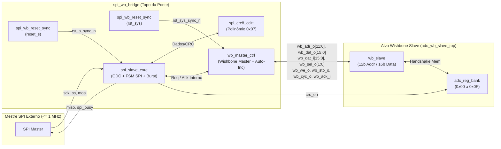

# Especificação de Design: Ponte SPI Slave para Wishbone Master (`spi_wb_bridge`)

## 1. Visão Geral e Arquitetura

O módulo [`spi_wb_bridge`](../rtl/src/spi_wb_bridge.sv) consiste em uma ponte digital que atua externamente como um **SPI Slave** (até $1\text{ MHz}$) e internamente como um **Wishbone Master** clássico (operando em pelo menos $100\text{ MHz}$), permitindo que um mestre SPI externo configure e leia o banco de registradores de 16 bits de um **ADC SAR de 10 bits** através de um escravo Wishbone (sub-bloco 1, `adc_wb_slave_top`, em `../../adc_wb_slave_regbank`).



---

## 2. Hierarquia de Arquivos

A estrutura de diretórios segue o mesmo fluxo do projeto `15_spi_master_coree`:

```text
spi_slave_wb_bridge/
├── doc/
│   └── Especificacao_Design_SPI_Slave_WB_Master.md
├── rtl/
│   ├── src/
│   │   ├── spi_wb_reset_sync.sv        # Sincronizador de reset (assert assíncrono, deassert síncrono)
│   │   ├── spi_crc8_ccitt.sv           # Motor combinacional CRC8-CCITT (Polinômio 0x07, Init 0x00)
│   │   ├── spi_slave_core.sv           # Núcleo SPI Slave (4 modos CPOL/CPHA, MSB/LSB, Burst)
│   │   ├── wb_master_ctrl.sv           # Controlador Wishbone Master com auto-incremento (+1)
│   │   ├── spi_wb_bridge.sv  # Topo da Ponte SPI Slave -> Wishbone Master
│   └── tb/
│       ├── spi_crc8_ccitt_tb.sv        # Testbench unitário do CRC8-CCITT
│       ├── spi_slave_core_tb.sv        # Testbench unitário do núcleo SPI Slave
│       └── spi_wb_bridge_tb.sv # Testbench completo de integração
└── workspace/
    └── rtlsim/
        ├── run.py                      # Script de compilação e simulação ModelSim/Questa
        └── cleanup.py                  # Script de limpeza dos artefatos de simulação
```

---

## 3. Requisitos de Clocks, Resets e Interface de Hardware (Portas)

### 3.1 Clocks e Domínios de Reset
- **`clk` ($\ge 100\text{ MHz}$)**: Clock principal do sistema e do barramento Wishbone.
- **`sck` ($\le 1\text{ MHz}$)**: Clock serial fornecido pelo mestre SPI externo. A razão de frequência ($\ge 100:1$) permite que a sincronização CDC (2 flip-flops), a leitura no barramento Wishbone e o cálculo do CRC8-CCITT ocorram em menos de $100\text{ ns}$, garantindo ampla margem antes da borda de lançamento de dados no `miso` ($500\text{ ns}$).
- **`reset_s` e `rst_sys`**: Ambos ativos em nível baixo (`0`), sincronizados internamente através de [`spi_wb_reset_sync`](../rtl/src/spi_wb_reset_sync.sv) com **ativação assíncrona** (`negedge`) e **desativação síncrona** (`posedge clk`).

### 3.2 Tabela de Portas do Topo (`spi_wb_bridge`)

| Sinal | Direção | Largura | Domínio | Descrição |
|---|---|---|---|---|
| `clk` | Input | 1 bit | Sistema | Clock principal do sistema e Wishbone ($\ge 100\text{ MHz}$) |
| `sck` | Input | 1 bit | SPI | Clock serial do SPI ($\le 1\text{ MHz}$) |
| `reset_s` | Input | 1 bit | SPI | Reset do domínio SPI Slave, ativo em nível baixo (`0`) |
| `rst_sys` | Input | 1 bit | Sistema | Reset do domínio do sistema/barramento, ativo em nível baixo (`0`) |
| `cpol` | Input | 1 bit | `clk` | Polaridade do `sck` em estado ocioso (`0` ou `1`) |
| `cpha` | Input | 1 bit | `clk` | Fase ativa de captura e lançamento do `sck` (`0` ou `1`) |
| `bit_order` | Input | 1 bit | `clk` | Ordem de serialização (`0`: LSB primeiro; `1`: MSB primeiro) |
| `ss` | Input | 1 bit | `sck` | Slave Select, ativo em nível baixo (`0`) |
| `mosi` | Input | 1 bit | `sck` | Entrada de dados serializados vindos do mestre externo |
| `miso` | Output | 1 bit | `clk` | Saída de dados serializados para o mestre (mantida em `'0'` no endereço e na escrita) |
| `spi_busy` | Output | 1 bit | `clk` | Flag ativa em nível baixo (`0` = transação em andamento; `1` = ocioso) |
| `wb_adr_o` | Output | 12 bits | `clk` | Endereço Wishbone Master |
| `wb_dat_o` | Output | 16 bits | `clk` | Dados de escrita Wishbone Master |
| `wb_dat_i` | Input | 16 bits | `clk` | Dados de leitura Wishbone Master |
| `wb_sel_o` | Output | 2 bits | `clk` | Seleção de bytes (`2'b11` para escrita de palavra completa de 16 bits) |
| `wb_we_o` | Output | 1 bit | `clk` | Write Enable (`1` = Escrita, `0` = Leitura) |
| `wb_stb_o` | Output | 1 bit | `clk` | Strobe válido da transferência Wishbone |
| `wb_cyc_o` | Output | 1 bit | `clk` | Ciclo de barramento Wishbone em andamento |
| `wb_ack_i` | Input | 1 bit | `clk` | Acknowledge retornado pelo escravo Wishbone |
| `crc_err` | Output | 1 bit | `clk` | Pulso/flag indicando divergência (mismatch) de CRC8-CCITT |

---

## 4. Protocolo de Comunicação, Burst, Auto-Incremento e CRC8-CCITT

### 4.1 Estrutura dos Pacotes (Opção B por padrão, Opção A parametrizável)
O parâmetro `CRC_HEADER_EN` seleciona entre as duas variações da especificação:
- **`CRC_HEADER_EN = 1'b0` (Opção B - Seção 6.3.4, Padrão)**:
  - **Cabeçalho (13 bits)**: `[1-bit Comando ('0'=Write, '1'=Read)] + [12-bit Endereço]`.
  - **Pacotes de Dados em Escrita ou Leitura (24 bits por palavra)**: `[16-bit Dados] + [8-bit CRC8-CCITT]`.
- **`CRC_HEADER_EN = 1'b1` (Opção A - Seção 6.3.3.14)**:
  - **Cabeçalho (21 bits)**: `[1-bit Comando] + [12-bit Endereço] + [8-bit CRC8-CCITT]`.
  - **Pacotes de Dados (24 bits por palavra)**: `[16-bit Dados] + [8-bit CRC8-CCITT]`.

### 4.2 Máquina de Estados e Operação Burst
- **Escrita (Single e Burst)**:
  1. Com `ss = 0`, o escravo recebe o bit de comando `'0'` e os 12 bits de endereço, mantendo `miso = 0`.
  2. Para cada pacote subsequente de 24 bits (`16-bit Dados + 8-bit CRC`), o módulo valida o CRC8-CCITT ($x^8 + x^2 + x + 1$, `0x07`).
  3. Se o CRC for válido, dispara a escrita Wishbone no endereço atual e incrementa automaticamente o endereço interno em $+1$ após `wb_ack_i`.
  4. Caso ocorra erro de CRC, a escrita no barramento é bloqueada para preservar os registradores e `crc_err` é ativado (`SPI_STATUS.ERR = 1`).
- **Leitura (Single e Burst)**:
  1. Ao capturar o 12º bit de endereço com comando `'1'`, o módulo realiza imediatamente a leitura no barramento Wishbone e auto-incrementa o endereço interno em $+1$.
  2. O dado lido de 16 bits e seu respectivo CRC8-CCITT de 8 bits são serializados na saída `miso` nas 24 bordas de lançamento (`launch_edge`) seguintes.
  3. Se `ss` permanecer ativo (`0`) ao término do 24º bit, o próximo endereço (já incrementado) é lido automaticamente no Wishbone e transmitido de forma contínua.

---

## 5. Mapa de Registradores Alvo (`adc_reg_bank.sv`)

| Endereço (Hex) | Nome | Bits e Campos | Descrição |
|---|---|---|---|
| `0x00` | `ADC_CTRL` | Bit 7 (`RESET`): `'1'` executa reset síncrono.<br>Bit 6 (`ENABLE`): `'1'` habilita o ADC, `'0'` desabilita. | Controle global do ADC SAR de 10 bits. |
| `0x01` | `SAMPLE_RATE` | Bits 7–0: Código de seleção da taxa de amostragem. | Define a frequência de amostragem do ADC. |
| `0x02` | `FILTER_CFG` | Bits 15–0: Definido pela aplicação. | Parâmetros do filtro digital. |
| `0x03` | `ADC_DATA` | Bits 9–0: Saída digital `d_out[9:0]` do ADC. | Leitura da palavra convertida pelo ADC. |
| `0x04` | `GAIN_CFG` | Bits 7–0: Valor de controle de ganho. | Ajuste de ganho de entrada. |
| `0x05` | `SPI_STATUS` | Bit 7 (`ERR`): `'1'` quando erro é detectado.<br>Bit 6 (`DATA_RDY`): `'1'` quando há novo dado.<br>Bits 5–0: Reservados (`0`). | Feedback de status (erros de CRC/barramento e conversão pronta). |
| `0x06–0x0F` | `Reserved` | Bits 15–0: Específicos da aplicação. | Reservados para expansão ou coeficientes de filtro. |

